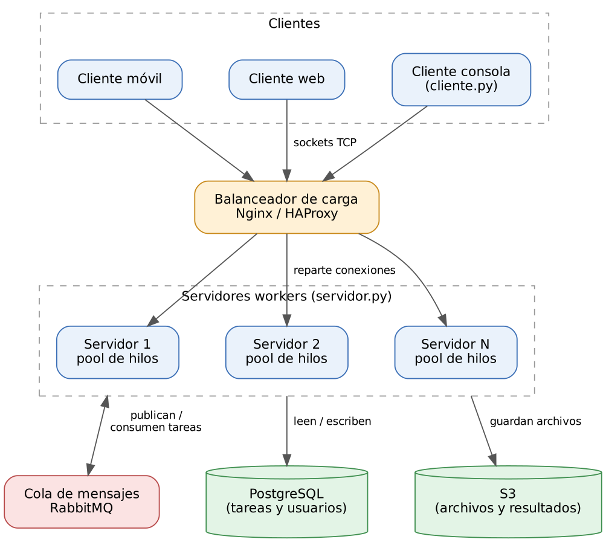

# PFO 3 - Rediseño como Sistema Distribuido (Cliente-Servidor)

Programación sobre redes - Santiago

## Diagrama del sistema



- **Clientes (móvil, web, consola):** se conectan por sockets TCP y mandan tareas.
- **Balanceador de carga (Nginx / HAProxy):** recibe todas las conexiones y las reparte entre los servidores.
- **Servidores workers:** cada uno tiene su pool de hilos para procesar varias tareas a la vez.
- **Cola de mensajes (RabbitMQ):** los servidores publican y consumen tareas ahí, así se comunican entre ellos y si uno se cae la tarea no se pierde.
- **Almacenamiento distribuido:** PostgreSQL para los datos (tareas, usuarios) y S3 para archivos.

## Qué implementa el código

El código es una versión reducida del diagrama que corre en una sola máquina, solo con la librería estándar de Python:

| En el diagrama | En el código |
|---|---|
| Clientes | `cliente.py` |
| Servidor worker con pool de hilos | `servidor.py` (4 hilos workers) |
| RabbitMQ | `queue.Queue` dentro del servidor |
| Balanceador, PostgreSQL, S3 | no implementados (solo diseño) |

Funcionamiento:

1. El cliente abre un socket TCP y manda la tarea como JSON, una por línea: `{"id": 1, "tipo": "mayusculas", "dato": "hola"}`.
2. El servidor atiende a cada cliente en un hilo y pone la tarea en la cola.
3. Un worker libre toma la tarea, la procesa y devuelve el resultado.
4. El servidor le responde al cliente: `{"id": 1, "estado": "ok", "resultado": "HOLA", "worker": "worker-2"}`.

Tareas disponibles: `mayusculas`, `invertir`, `contar` (palabras) y `sumar`. Cada tarea tarda 1 segundo a propósito, para que se note el trabajo en paralelo.

## Cómo ejecutarlo

Requiere Python 3. No hay que instalar nada.

Terminal 1:

```bash
python servidor.py
```

Terminal 2:

```bash
python cliente.py         # menú interactivo
python cliente.py demo    # 4 clientes al mismo tiempo, 2 tareas cada uno
```

En el modo `demo` las 8 tareas se resuelven en unos 2 segundos en vez de 8, porque se reparten entre los 4 workers.
